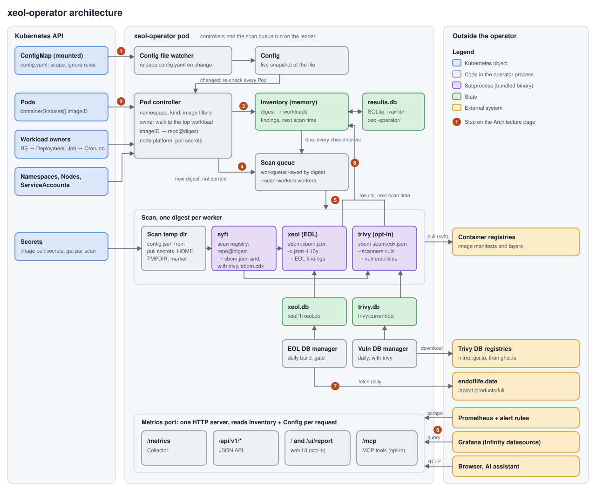

# Architecture

How xeol-operator finds the images your cluster runs, scans them, and serves the results. For install and day-to-day use see [usage.md](usage.md); for chart values see [helm.md](helm.md).

The numbers in the diagram match the steps under [How it works](#how-it-works).

## Components

Everything runs in one pod. There are no scan Jobs, no Secrets created by the operator, and no external database.

| Component | Code | Job |
|---|---|---|
| XeolScanner reconciler | `internal/controller/xeolscanner_controller.go` | Reads `XeolScanner/default` into a live `Config` and writes its status every minute |
| Pod controller | `internal/controller/pod_controller.go` | Turns running Pods into image digests, each attributed to its top-level workload |
| Inventory | `internal/controller/inventory.go` | In-memory map of digest → workloads, pull secrets, findings, next scan time |
| Results store | `internal/results` | SQLite copy of each digest's last scan, so a container restart doesn't rescan everything |
| Scan queue | `internal/scanner/queue.go` | Workqueue keyed by digest with `--scan-workers` workers and a ticker for due rescans |
| Scanner | `internal/scanner/xeol.go` | Runs syft then xeol as subprocesses and parses the result into flat findings |
| EOL DB manager | `internal/eoldb` | Builds xeol's database from endoflife.date at startup and daily, or reads a mounted one |
| Collector | `internal/metrics/collector.go` | Renders Prometheus metrics from the Inventory on each scrape |
| HTTP API, UI, MCP | `internal/api` | JSON API, web page and MCP tools on the metrics port, read from the Inventory |

## How it works

### 1. Configuration

The chart writes your `scanner.*` values into the cluster-wide `XeolScanner` named `default`. The reconciler parses it (namespace selector, globs, interval, workload kinds and labels, ignore rules) into a `Config` snapshot that every other component reads.

- When the spec changes, every Pod is re-evaluated against it. No restart is needed.
- An invalid spec sets `Ready=False` with reason `InvalidSpec`. Any other name than `default` is rejected.
- Deleting `XeolScanner/default` clears the Inventory and stops scanning until it is recreated.
- Every minute the reconciler writes `status`: images scanned, EOL findings, last sweep, DB build time, and the `Ready` and `DBStale` conditions.

### 2. Discovery

Only Pods are watched. For each Pod the controller:

1. Drops it if it is finished (`Succeeded`/`Failed`), terminating, in an excluded namespace, or outside the namespace selector.
2. Walks controller `ownerReferences` up to the top-level workload: Pod → ReplicaSet → Deployment, Pod → Job → CronJob, or any other kind such as an Argo Rollout. Owners are read as metadata only.
3. Keeps the Pod only if that workload's kind is in `workloadKinds` (default Deployment, StatefulSet, DaemonSet, Job, CronJob; `[]` means every kind).
4. Reads each container's `imageID` from the Pod status and splits it into repository and digest. A bare `sha256:...` (an image loaded straight onto the node) has no registry to pull from and is skipped, as is anything matching `excludeImages`.
5. Collects the Pod's and its ServiceAccount's `imagePullSecrets`, and the node's `os/arch` so multi-arch images are scanned for the variant that runs.

### 3. Inventory

Each image becomes an entry keyed by digest. Ten Pods running the same digest are one entry with ten owners, and one scan.

When a digest is new to the Inventory, its saved result is looked up in SQLite. If that result is still current (its next scan time is in the future) it is restored and no scan is queued. Otherwise the digest is queued (step 4).

When the last Pod running a digest goes away, the digest leaves the Inventory, and its metric series disappear on the next scrape. Its saved result stays in SQLite for a week past its next scan time, so an image that comes back (a CronJob's next run) is restored instead of rescanned.

### 4. Scheduling

The scan queue is a client-go workqueue keyed by digest: a digest already queued is not added twice, and one digest is never scanned by two workers at once.

- New digests are added by the Pod controller straight away.
- Every `--scan-check-interval` (Helm `scanner.checkInterval`, default `1m`) a ticker adds digests whose next scan time has passed.
- Scanning only starts once the EOL database is ready.
- `--scan-workers` (default `1`) sets how many scans run at once. Each needs its own memory.

### 5. Scan

For one digest a worker:

1. Builds a `config.json` from the pull secrets (read from the API server at that moment, never cached) in a fresh temp dir under `/tmp`. The same dir is `HOME`, `TMPDIR` and `DOCKER_CONFIG` for both subprocesses.
2. Writes an in-flight marker for the digest (see [Failure handling](#failure-handling)).
3. Runs `syft scan registry:<repo>@<digest> --platform <os/arch> -o syft-json=sbom.json`, pulling the image from its registry. The cataloger selection matches what xeol itself would use.
4. Runs `xeol sbom:sbom.json -o json -q -l 10y` against the local EOL database, with auto-update and the age check turned off. `--api-key` is never passed, so nothing is uploaded.
5. Parses xeol's JSON into flat findings (product, cycle, EOL date, package, version, type, purl, distro, endoflife.date URL), dropping repeats of the same package found at several paths.
6. Deletes the temp dir and the marker.

syft and xeol get `GOMEMLIMIT` (`scanner.goMemLimit`) and `GOMAXPROCS` (`scanner.maxProcs`) so they stay inside the pod's limits, and the whole scan is bounded by `scanner.timeout`.

### 6. Results

The result goes into the Inventory and into SQLite with a next scan time:

- Success: `now + spec.interval` (default `24h`).
- Failure: `now + 1h`. The previous findings are kept, and the error reason is recorded.

Each digest is rescanned on its own schedule, not all at once. A database rebuild does not trigger rescans; the EOL date is stored, and "already EOL" is worked out at query time, so only new endoflife.date data waits for the next rescan.

### 7. EOL database

In `online` mode (the default) the EOL DB manager downloads `https://endoflife.date/api/v1/products/full` at startup and every 24 hours and builds xeol's SQLite database from it. A build is written to a temp dir and swapped in only when complete, so a failed build keeps the previous database and is retried the next day (every 30 seconds while there is no usable database). The operator never contacts `data.xeol.io`.

In `mounted` mode it reads a prebuilt database from a volume instead (air-gapped, see [air-gapped.md](air-gapped.md)).

The pod is Ready once a valid database has existed at least once, checked with `xeol db status`. The build time is exported as `xeol_db_built_timestamp_seconds` and the `DBStale` condition turns true after 30 days.

### 8. Export

One HTTP server on the metrics port serves everything, read from the Inventory and Config on each request. Nothing is pushed anywhere.

| Path | What | Enabled by |
|---|---|---|
| `/metrics` | Prometheus metrics (see the [README](../README.md#metrics)) | always |
| `/api/v1/status`, `/namespaces`, `/workloads`, `/findings` | Read-only JSON for Grafana's Infinity datasource | always |
| `/`, `/ui/report` | Server-rendered web page | `ui.enabled` |
| `/mcp` | The same four views as MCP tools (Streamable HTTP) | `mcp.enabled` |

`ignoreProducts` rules are applied here, at export time, so changing them takes effect without a rescan.

The metrics come from a custom collector that builds every series from the Inventory on each scrape. When an image stops running there is nothing to delete; its series simply stop appearing. Findings are one series per (digest, product, cycle, package, version) and workloads one series per (digest, workload), joined on `digest`, so cardinality does not grow with Pod count.

## Where data is stored

| What | Path in the container | Volume | Survives |
|---|---|---|---|
| EOL database (converted for xeol) | `/var/cache/xeol/1/xeol.db` | `xeol-db` emptyDir | container restart; rebuilt on a new pod |
| EOL database metadata (build time, checksum) | `/var/cache/xeol/1/metadata.json` | `xeol-db` emptyDir | same |
| EOL database in `mounted` mode | `<db.mounted.path>/1/xeol.db`, default `/xeol-db/1/xeol.db` | your volume, read-only | as long as the volume |
| Scan results cache (SQLite) | `/var/lib/xeol-operator/results.db` | `state` emptyDir | container restart; a new pod starts empty |
| In-flight scan markers | `/var/lib/xeol-operator/inflight/<digest>` | `state` emptyDir | container restart (that is the point) |
| Per-scan temp dir (pull credentials, SBOM, image layers) | `/tmp/scan-*` | `tmp` emptyDir | deleted when the scan ends |

Paths come from `--db-dir` and `--state-dir`, which the chart sets. During a rebuild the new database is written to `/var/cache/xeol/.build-*` and moved into place; the previous copy is briefly kept as `/var/cache/xeol/1.old`.

`results.db` has one table, `results`, with one row per digest: `digest`, `scanned_at`, `next_at`, `err_reason`, and `findings` as JSON. Rows are dropped once they are a week past their next scan time. Entity diagrams of both SQLite files are in the OpenSpec specs: `results.db` in [image-scanning](../openspec/specs/image-scanning/spec.md#data-model), `xeol.db` in [eol-database](../openspec/specs/eol-database/spec.md#data-model).

## Failure handling

| Situation | What happens |
|---|---|
| Registry auth, image not found, timeout | Recorded with reason `auth`, `not_found`, `timeout` or `other`, counted in `xeol_scan_errors_total`, retried after 1h with the previous findings kept |
| A scan runs the pod out of memory | The container restarts and finds the digest's in-flight marker. If that scan was running alone, the digest is skipped for 24h with reason `oom` instead of crash-looping. If other scans were running too, it is rescanned alone first to find the culprit |
| endoflife.date unreachable | The current database stays in use; with none yet the pod stays unready and scans wait |
| Container restart | The Inventory is rebuilt from Pods and results are restored from `results.db`; only overdue digests are rescanned |
| New pod (upgrade, reschedule) | All volumes are emptyDirs, so the database is rebuilt and every image is scanned again |

## Leader election and replicas

The chart runs one replica with leader election on. The Pod controller, the XeolScanner reconciler and the scan queue run only on the leader, so only the leader has an Inventory. A standby still builds its own EOL database, so it can take over, and answers `503` on the JSON API, the web page and MCP. Metrics on a standby contain only the database build time and empty scan counters.

## Security

- RBAC is read-only: get/list/watch on Pods, Namespaces, Nodes, ServiceAccounts and the apps/batch workload kinds, `get` on Secrets, and status updates on `XeolScanner`. The operator creates nothing in the cluster.
- Pull secrets are read one `get` at a time when a scan starts, never cached or listed, written to a `0600` file in that scan's temp dir, and deleted with it. They are never logged.
- The container runs as non-root with a read-only root filesystem; every writable path is one of the emptyDirs above.
- The web page, MCP and JSON API have no login. Reach them with `port-forward` and keep them off public Ingress.

## Design choices

- **Digest, not tag or PodSpec.** The digest in `imageID` is exactly what runs. A re-pushed tag is caught as soon as Pods restart, a template change that keeps the image (env, resources) costs nothing, and an image shared by many workloads is scanned once.
- **In-process scans, not Jobs.** syft and xeol are bundled in the operator image and run as subprocesses. No Jobs, temp Secrets or log scraping; the trade-off is that one pod's CPU and memory limit how many scans run at once.
- **Running Pods only.** Old ReplicaSets and unused templates are never scanned. CronJob images are only exported while a run's Pod exists.
- **Metrics built on scrape.** Nothing to reconcile or delete when images stop running, and a restart can't leave stale series.
- **EOL data built locally.** xeol is only the matcher; the database comes from endoflife.date, which also covers distros (Debian, Alpine, Ubuntu) that xeol's own database misses.
