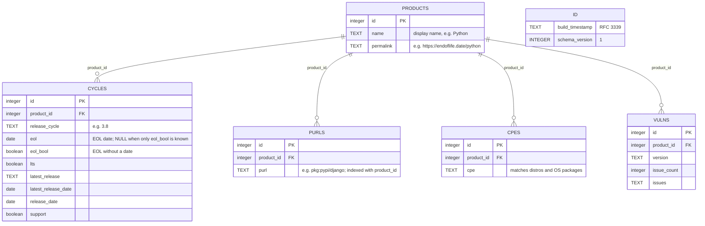

# eol-database Specification

## Purpose
Keep a current xeol database, built by the operator from endoflife.date, available to every scan.

## Requirements

### Requirement: Build from endoflife.date
In `--db-source=online` (default), the operator SHALL build xeol's DB (`<db-dir>/1/xeol.db` + `metadata.json`) from endoflife.date's `products/full` at startup and every 24h, filling CPEs so distros match. In `--db-source=mounted` it SHALL only read a provided volume. With `--eol=false`, it SHALL neither build nor read the EOL DB, and readiness SHALL not wait for it.

#### Scenario: Startup
- **WHEN** the operator starts online
- **THEN** it builds the DB, and the readiness probe fails until a DB is usable (`xeol db status` reports valid)

#### Scenario: EOL scanning off
- **WHEN** the operator starts with `--eol=false --trivy`
- **THEN** it makes no request to endoflife.date and becomes Ready once the trivy DB is usable

### Requirement: Failed rebuild keeps the old DB
A build SHALL be written to a temporary directory and swapped in only when complete. A failed rebuild SHALL log the error and keep the previous DB.

#### Scenario: endoflife.date down with a usable DB
- **WHEN** a rebuild fails and the existing DB is usable
- **THEN** it logs "EOL database rebuild failed; keeping the previous one" and tries again after 24h, not sooner

#### Scenario: No usable DB yet
- **WHEN** a build fails and there is no usable DB
- **THEN** it retries every 30s

### Requirement: DB age
xeol's own age check SHALL be disabled (`XEOL_DB_VALIDATE_AGE=false`); the build time SHALL be exported as `xeol_db_built_timestamp_seconds` and as `db_built`/`db_age_seconds` in `/api/v1/status`, and alerted on (`XeolDatabaseStale`, 30 days by default).

#### Scenario: Old mounted DB
- **WHEN** a mounted DB is 40 days old
- **THEN** scans still run and the stale-DB alert fires

## Data model

`<db-dir>/1/xeol.db` (`/var/cache/xeol/1/xeol.db` in the chart), with its build time in `<db-dir>/1/metadata.json`. The schema is xeol's; the operator fills it from endoflife.date (`internal/eoldb/build.go`). The `product_id` columns are not declared as foreign keys in SQLite; the relations below are how xeol joins them. `vulns` is created for xeol's schema and left empty.

