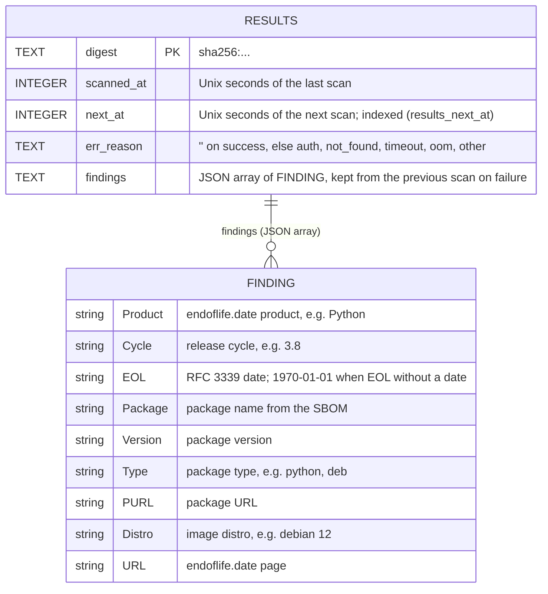

# image-scanning Specification

## Purpose
Scan each running image digest for end-of-life software with syft and xeol, within bounded resources.

## Requirements

### Requirement: Two-step scan
Each scan SHALL run the bundled syft to write an SBOM of `registry:<repo>@<digest>` (with xeol's cataloger selection), then `xeol sbom:<file> -o json -q -l 10y` against the operator's DB, with `XEOL_DB_AUTO_UPDATE=false`. The scanner SHALL return flat findings (product, cycle, EOL date, package, version, endoflife.date URL), each (product, cycle, package, version) once. The operator SHALL never pass `--api-key` or contact `data.xeol.io`.

#### Scenario: Python 3.8 image
- **WHEN** `python:3.8-slim` is scanned
- **THEN** a finding with product `Python`, cycle `3.8` and its EOL date is recorded

### Requirement: Bounded queue
Scans SHALL run off the reconcile loop in a work queue keyed by digest with `--scan-workers` workers (default 1), each bounded by `--scan-timeout` (default 5m), `GOMEMLIMIT` and `GOMAXPROCS`.

#### Scenario: Digest already queued
- **WHEN** a digest is being scanned and becomes due again
- **THEN** it is not queued twice

### Requirement: Rescan schedule
Each digest SHALL be rescanned `spec.interval` after its own last scan, against the DB current at that time. A DB rebuild SHALL NOT trigger rescans: results hold the EOL date and "already EOL" is computed at query time.

#### Scenario: EOL date passes
- **WHEN** a finding's EOL date passes between scans
- **THEN** it shows as already EOL with no rescan

### Requirement: Scan errors
A failed scan SHALL be recorded with a reason: `auth`, `not_found`, `timeout`, `oom` or `other`.

#### Scenario: OOM-killed pod
- **WHEN** an image's scan OOM-kills the operator container
- **THEN** after the restart that image is skipped for 24h with reason `oom` instead of crash-looping

### Requirement: Saved results
Each digest's last scan SHALL be saved to SQLite at `<state-dir>/results.db`. After a container restart, a re-seen digest SHALL get its saved result back and be rescanned only if overdue.

#### Scenario: Restart mid-interval
- **WHEN** the container restarts 2h after a digest was scanned with a 24h interval
- **THEN** its findings are restored and it is not rescanned

## Data model

`<state-dir>/results.db` (`/var/lib/xeol-operator/results.db` in the chart) holds one row per image digest. `findings` is a JSON array; its elements are shown as `FINDING` below but are not a separate table. Rows are deleted once `next_at` is more than a week in the past (`internal/results/results.go`).

