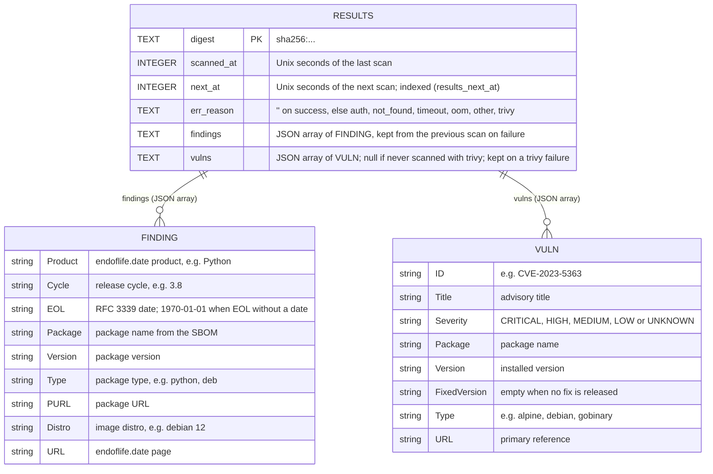

# image-scanning Specification

## Purpose
Scan each running image digest with syft, then xeol (end-of-life software) and/or trivy (known vulnerabilities), within bounded resources.

## Requirements

### Requirement: Two-step scan
Each scan SHALL run the bundled syft to write an SBOM of `registry:<repo>@<digest>` (with xeol's cataloger selection), then `xeol sbom:<file> -o json -q -l 10y` against the operator's DB, with `XEOL_DB_AUTO_UPDATE=false`. The scanner SHALL return flat findings (product, cycle, EOL date, package, version, endoflife.date URL), each (product, cycle, package, version) once. The operator SHALL never pass `--api-key` or contact `data.xeol.io`.

#### Scenario: Python 3.8 image
- **WHEN** `python:3.8-slim` is scanned
- **THEN** a finding with product `Python`, cycle `3.8` and its EOL date is recorded

### Requirement: One syft run per scan
With `--trivy`, the same syft run SHALL also write a CycloneDX SBOM for the vulnerability step; syft SHALL still run once per scan. With `--eol=false`, xeol SHALL not run and syft SHALL write only the CycloneDX SBOM.

#### Scenario: Trivy only
- **WHEN** a digest is scanned with `--eol=false --trivy`
- **THEN** syft writes only CycloneDX, xeol does not run, and only vulnerability rows are recorded

#### Scenario: One syft run with trivy enabled
- **WHEN** a digest is scanned with `--trivy`
- **THEN** syft runs once, and both xeol and trivy read SBOMs from that run

### Requirement: Bounded queue
Scans SHALL run off the reconcile loop in a work queue keyed by digest with `--scan-workers` workers (default 1), each bounded by `--scan-timeout` (default 5m), `GOMEMLIMIT` and `GOMAXPROCS`.

#### Scenario: Digest already queued
- **WHEN** a digest is being scanned and becomes due again
- **THEN** it is not queued twice

### Requirement: Rescan schedule
Each digest SHALL be rescanned the config file's `interval` after its own last scan, against the DB current at that time. A DB rebuild SHALL NOT trigger rescans: results hold the EOL date and "already EOL" is computed at query time.

#### Scenario: EOL date passes
- **WHEN** a finding's EOL date passes between scans
- **THEN** it shows as already EOL with no rescan

### Requirement: Scan errors
A failed scan SHALL be recorded with a reason: `auth`, `not_found`, `timeout`, `oom`, `other` or `trivy`. A failure in the trivy step alone SHALL be recorded as `trivy`, keep that scan's EOL findings, and keep the digest's previous vulnerability rows.

#### Scenario: OOM-killed pod
- **WHEN** an image's scan OOM-kills the operator container
- **THEN** after the restart that image is skipped for 24h with reason `oom` instead of crash-looping

#### Scenario: Trivy step fails
- **WHEN** syft and xeol succeed and trivy exits with an error
- **THEN** the new EOL findings are recorded, the previous vulnerability rows are kept, and `xeol_scan_errors_total{reason="trivy"}` increases

### Requirement: Saved results
Each digest's last scan SHALL be saved to SQLite at `<state-dir>/results.db`, including its vulnerability rows when `--trivy` is on. After a container restart, a re-seen digest SHALL get its saved result back and be rescanned only if overdue.

#### Scenario: Restart mid-interval
- **WHEN** the container restarts 2h after a digest was scanned with a 24h interval
- **THEN** its findings are restored and it is not rescanned

### Requirement: Scan types are switchable
EOL scanning SHALL be on unless `--eol=false` (Helm `eol.enabled`, default true); vulnerability scanning SHALL be off unless `--trivy` (Helm `trivy.enabled`, default false). At least one SHALL be on: the operator SHALL exit at startup with an error naming both flags, and the Helm chart SHALL refuse to render, when both are off.

#### Scenario: Defaults
- **WHEN** the chart is installed with default values
- **THEN** EOL scanning runs and vulnerability scanning does not, as before this change

#### Scenario: Both off
- **WHEN** the operator starts with `--eol=false` and without `--trivy`
- **THEN** it exits with an error saying at least one of `--eol` or `--trivy` must be on

### Requirement: Scan files are removed
A scan's working directory (SBOMs, unpacked layers, credentials) SHALL be deleted when the scan returns, before the next image is scanned, on success or failure. At startup, the operator SHALL delete working directories left by scans that a container restart interrupted.

#### Scenario: Next image
- **WHEN** a scan with EOL and trivy finishes and the worker takes the next digest
- **THEN** no SBOM or layer file of the previous scan remains on disk

#### Scenario: Restart after an OOM kill
- **WHEN** the container restarts after being killed mid-scan
- **THEN** the interrupted scan's working directory is deleted before scanning resumes

## Data model

`<state-dir>/results.db` (`/var/lib/xeol-operator/results.db` in the chart) holds one row per image digest. `findings` and `vulns` are JSON arrays; their elements are shown as `FINDING` and `VULN` below but are not separate tables. Rows are deleted once `next_at` is more than a week in the past (`internal/results/results.go`).

