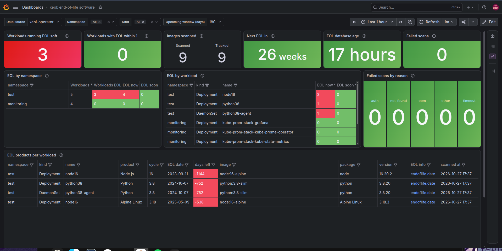
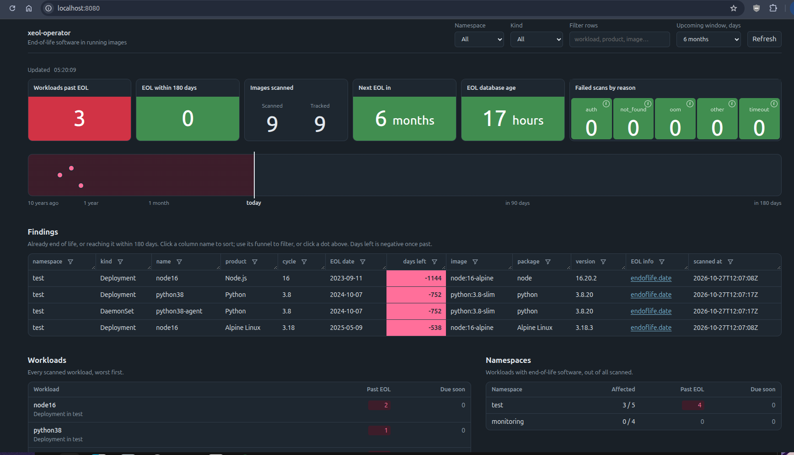

The Helm chart is the supported way to install the operator. It gives you:

- one operator pod, with syft, xeol and trivy bundled,
- the scan config file, as a ConfigMap,
- optional wiring for Prometheus, alerts and a Grafana dashboard.

The chart is published at `https://rishang.github.io/xeol-operator`, one version per release. It is also listed on [Artifact Hub](https://artifacthub.io/packages/helm/xeol-operator/xeol-operator). Its source is in [`helm/xeol-operator`](https://github.com/Rishang/xeol-operator/tree/main/helm/xeol-operator).

[](https://artifacthub.io/packages/helm/xeol-operator/xeol-operator)

## Requirements

- Helm 3.
- Egress to `endoflife.date` (or see [Air-gapped installation](/xeol-operator/air-gapped/)).
- Egress to the registries your images come from.
- Optional, for the ServiceMonitor and PrometheusRule: the Prometheus Operator (e.g. kube-prometheus-stack).
- Optional, for the dashboard: Grafana with its sidecar, plus the [Infinity](https://grafana.com/grafana/plugins/yesoreyeram-infinity-datasource/) plugin.

## Install

Add the chart repository once:

```bash
helm repo add xeol-operator https://rishang.github.io/xeol-operator
helm repo update
```

Minimal install (metrics only):

```bash
helm install xeol-operator xeol-operator/xeol-operator -n xeol-system --create-namespace
```

With kube-prometheus-stack and Grafana:

```bash
# serviceMonitor.enabled     Prometheus scrapes the EOL metrics (PromQL, history). Needs the Prometheus Operator.
# prometheusRule.enabled     Alert rules: EOL software running or due soon, stale DB, failing scans. Needs the ServiceMonitor.
# grafanaDatasource.enabled  Infinity datasource + dashboard, loaded by Grafana's sidecars. Needs the Infinity plugin.
helm install xeol-operator xeol-operator/xeol-operator -n xeol-system --create-namespace \
  --set serviceMonitor.enabled=true \
  --set prometheusRule.enabled=true \
  --set grafanaDatasource.enabled=true
```

The pod turns Ready once the first EOL database build succeeds. Scanning starts then.

To add vulnerability scanning with trivy, run the command below. trivy reads the same SBOM, so there's no second image pull. The pod also downloads trivy's ~1.6 GB database before it turns Ready.

```bash
helm upgrade xeol-operator xeol-operator/xeol-operator -n xeol-system --reuse-values --set trivy.enabled=true
```

Check that it works:

```bash
kubectl -n xeol-system logs deploy/xeol-operator | grep -E 'scanned|scan failed'
kubectl -n xeol-system port-forward svc/xeol-operator-metrics 8080 &
curl -s localhost:8080/api/v1/status
curl -s localhost:8080/metrics | grep ^xeol_
```

## What gets installed

| Kind | Name | When |
|---|---|---|
| ServiceAccount, ClusterRole, ClusterRoleBinding | `xeol-operator` | always |
| Role, RoleBinding | `xeol-operator-leader-election` | always |
| Service | `xeol-operator-metrics` (port 8080: `/metrics`, `/api/v1/*`) | always |
| Deployment | `xeol-operator` | always |
| ConfigMap | `xeol-operator-config` (the [config file](/xeol-operator/configuration/)) | always, from `scanner.*` |
| ServiceMonitor | `xeol-operator` | `serviceMonitor.enabled` |
| PrometheusRule | `xeol-operator` | `prometheusRule.enabled` |
| ConfigMap | `xeol-operator-datasource` | `grafanaDatasource.enabled` |
| ConfigMap | `xeol-operator-dashboard` | `grafanaDatasource.enabled` |

Notes:

- `xeol-operator-config` is mounted at `/etc/xeol-operator/`.
- `xeol-operator-dashboard` holds `xeol.json` with `eol.enabled`, and `xeol-trivy.json` with `trivy.enabled`.

RBAC is read-only. The operator can read Pods, Namespaces, ServiceAccounts, Nodes, Secrets (only to read image pull secrets) and apps/batch workloads. The chart installs no CRD.

## Features

Out of the box, the operator scans and serves `/metrics` and the JSON API (`/api/v1/*`) on port 8080. Everything else is opt-in.

Each feature reads the same in-memory results. None depends on another unless noted.

| Feature | Value | Gives you | Needs |
|---|---|---|---|
| Scan types | `eol.enabled` (on), `trivy.enabled` (off) | End-of-life software and/or known vulnerabilities | trivy: egress to its DB registry or a mounted DB, a 5Gi volume |
| Metrics collection | `serviceMonitor.enabled` | EOL findings in Prometheus: PromQL, history | Prometheus Operator |
| Alerts | `prometheusRule.enabled` | Notifications through Alertmanager | Prometheus Operator, and the ServiceMonitor for data |
| Grafana dashboard | `grafanaDatasource.enabled` | Datasource + ready-made dashboard | Grafana sidecars, Infinity plugin |
| Built-in web page | `ui.enabled` | Dashboard without Grafana | A browser and `kubectl port-forward` |
| MCP tools | `mcp.enabled` | Ask an AI assistant about EOL findings | An MCP client and `kubectl port-forward` |
| EOL data source | `db.source` | Online (daily from endoflife.date) or a mounted DB | Egress, or a DB you ship |

### Metrics collection: `serviceMonitor.enabled`

**Use it to** get findings into Prometheus. You can then query them with PromQL, keep history, and build your own panels or alerts.

**Creates** a `ServiceMonitor`. It tells the Prometheus Operator to scrape `xeol-operator-metrics:8080/metrics` every `serviceMonitor.interval` (60s).

**How it works:** on each scrape, the operator answers from memory. So an image that stops running loses its series straight away. The metrics are listed in the [README](https://github.com/Rishang/xeol-operator#metrics).

**Leave it off** if you have no Prometheus Operator. You can still scrape the Service yourself. Or skip Prometheus entirely: the dashboard, web page and MCP don't need it.

**Check:** in Prometheus → Status → Targets, the target `serviceMonitor/xeol-system/xeol-operator` is `UP`. By default, kube-prometheus-stack only selects ServiceMonitors labelled `release: <its release>`. If yours does, set `serviceMonitor.labels.release`.

### Alerts: `prometheusRule.enabled`

**Use it to** get told about EOL software, instead of having to look. It holds only alert rules (no recording rules), so nothing else depends on it.

**Creates** a `PrometheusRule`. Here's the path an alert takes:

1. The Prometheus Operator loads the rule into Prometheus.
2. Prometheus evaluates it every minute and sends firing alerts to Alertmanager.
3. Alertmanager routes them to Slack, PagerDuty, email and so on.

| Alert | Fires when | Severity |
|---|---|---|
| `XeolEOLSoftwareRunning` | Software already past EOL runs, for 10 minutes. | warning |
| `XeolEOLSoftwareSoon` | Software reaches EOL within `prometheusRule.eolSoonDays` (90), for 1 hour. | info |
| `XeolDatabaseStale` | The EOL database is older than `prometheusRule.dbStaleDays` (30). | warning |
| `XeolDatabaseMissing` | No EOL database for 30 minutes, so nothing is scanned. | warning |
| `XeolScanErrors` | More than 5 scans failed with one reason in the last hour, for 15 minutes. | info |

The last three tell you the operator itself is unhealthy. An empty dashboard can't tell you that: no findings could mean "all good" or "scanning stopped".

Alerts fire per image and product, not per workload. To route by team, set `scanner.workloadLabels: [team]`. Then write your own rule that joins `xeol_image_workload` on `digest`.

**Leave it off** in these cases:

- You have no Prometheus Operator. The `PrometheusRule` kind won't exist, and the install fails.
- You write your own rules.

Without the ServiceMonitor, the rules have no data. Only `XeolDatabaseMissing` would fire.

**Check:** Prometheus → Alerts lists the `xeol-operator` group. Some setups select rules by label; if so, set `prometheusRule.labels.release`.

### Grafana dashboard: `grafanaDatasource.enabled`

**Use it to** get a ready-made Grafana dashboard. It shows:

- headline stats,
- EOL by namespace and workload,
- a per-workload product table (red past EOL, yellow within 6 months),
- the full findings list.

You can filter it by namespace, kind and an upcoming window.



**Creates** two ConfigMaps in the operator's namespace:

- `xeol-operator-datasource`, labelled `grafana_datasource: "1"`: an [Infinity](https://grafana.com/grafana/plugins/yesoreyeram-infinity-datasource/) datasource (uid `xeol-operator`) pointing at `http://xeol-operator-metrics.<namespace>.svc:8080`.
- `xeol-operator-dashboard`, labelled `grafana_dashboard: "1"`: the dashboard JSON.

**How it works:** the chart never contacts Grafana. Instead:

1. Grafana's sidecar containers (`grafana-sc-datasources` and `grafana-sc-dashboard`, in the Grafana pod) watch for ConfigMaps with those labels.
2. They write them into Grafana's provisioning folders and reload Grafana.
3. The dashboard's panels query the operator's JSON API from the Grafana server, inside the cluster.

The dashboard doesn't read Prometheus, so it works without the ServiceMonitor.

**Needs** on the Grafana side:

- The Infinity plugin (kube-prometheus-stack: `grafana.plugins: [yesoreyeram-infinity-datasource]`).
- Sidecars that watch the operator's namespace. Set `grafana.sidecar.datasources.searchNamespace` and `grafana.sidecar.dashboards.searchNamespace` to `ALL` (or to a list that includes it).
- Matching labels. If your sidecars use other labels, change `grafanaDatasource.labels` / `grafanaDashboard.labels`. `grafanaDashboard.annotations` can set a folder (e.g. `grafana_folder: Security`).
- Network access from Grafana to the operator's Service on port 8080.

**Leave it off** if you have no Grafana sidecars. Then set things up by hand: add an Infinity datasource with uid `xeol-operator` and the URL above, and import `helm/xeol-operator/dashboards/xeol.json`.

**Check:** `kubectl -n <grafana-ns> logs deploy/<grafana> -c grafana-sc-datasources | grep xeol` shows `Writing .../xeol-operator-datasource.yaml`.

### Built-in web page: `ui.enabled`

**Use it** in clusters without Grafana, or for a quick look without setting up dashboards.



**Serves** a page at `/` on port 8080. It has:

- tiles: workloads past EOL and due soon, days to the next EOL, EOL database age, and failed scans by reason (hover ⓘ for the affected workloads);
- a timeline with one dot per product release, by EOL date; click a dot to filter the findings;
- a findings table with sorting, per-column filters and resizable columns;
- workload and namespace summaries, and namespace, kind, text and window filters.

```bash
kubectl -n xeol-system port-forward deploy/xeol-operator 8080   # then open http://localhost:8080/
```

**How it works:** the operator renders the HTML. To update the page in place, the browser loads htmx 2.0.4 from jsDelivr (pinned and integrity-checked). If the browser has no internet access, filters still work by reloading the page. Nothing is stored; the page is read-only.

**Leave it off** if nobody will use it. It has no authentication. Reach it by port-forward, never through a public Ingress.

### MCP tools: `mcp.enabled`

**Use it to** ask an AI assistant questions like "which prod workloads run EOL software?". This works with Claude Code, Claude Desktop, or any MCP client. (MCP, the Model Context Protocol, lets AI assistants call tools.)

**Serves** an MCP endpoint at `/mcp` (Streamable HTTP, stateless). It has four read-only tools: `status`, `namespaces`, `workloads` and `findings`. Each takes optional `namespace`, `kind` and `within_days` parameters. Each returns the same JSON as the matching `/api/v1/*` endpoint.

```bash
kubectl -n xeol-system port-forward deploy/xeol-operator 8080
claude mcp add --transport http xeol http://localhost:8080/mcp
```

**Leave it off** if you don't use MCP clients. Like the web page, it has no authentication. Cross-origin browser requests are refused, so a web page can't call it.

**`mcp.allowRescan`** (default `false`) adds a fifth tool, `rescan`, that queues an immediate rescan of all or matching images. It's the only tool that changes anything, so it's opt-in: anyone who reaches the port could queue rescans. Without it, rescan from inside the pod; see [Rescan now](/xeol-operator/usage/#8-rescan-now).

### Scan types: `eol.enabled`, `trivy.enabled`

syft pulls and catalogs each image once. The resulting SBOM (a list of the software in the image) then goes to each enabled scanner. At least one scanner must be on; otherwise the chart refuses to render.

- **`eol.enabled` (default `true`):** xeol matches the SBOM against the EOL database (`db.*`). When off, no EOL database is built or required. The EOL metrics, alerts, dashboard and web page tab are left out.
- **`trivy.enabled` (default `false`):** `trivy sbom` matches the same SBOM against trivy's vulnerability database. It adds about 0.2 s and 150 MB per scan; peak memory is still syft's. With trivy on you also get:
  - the metrics `xeol_vulnerabilities{digest,severity,fixable}` (counts, never one series per CVE) and `xeol_vuln_db_updated_timestamp_seconds`;
  - the `/api/v1/vulnerabilities` endpoint;
  - the `XeolVulnDatabaseStale` alert;
  - the trivy Grafana dashboard and the web page's Trivy tab.
- **When a trivy step fails:** the image keeps its EOL findings and its previous vulnerabilities. The failure counts as `xeol_scan_errors_total{reason="trivy"}` and is retried after 1h.
- **trivy database:** follows `db.source`.
  - Online: downloaded at start and daily from `mirror.gcr.io/aquasec/trivy-db:2` (fallback `ghcr.io/aquasecurity/trivy-db:2`, or `trivy.dbRepository`). It's stored in an emptyDir of size `trivy.dbSizeLimit`.
  - Mounted: read from `trivy.mounted.volume`.
  - Either way, scans themselves never download anything or call out. Only the main database is used, not trivy's Java database.
- **trivy only knows what syft records:** OS and language packages. Software copied into an image outside a package manager (e.g. a Python built from source) has no vulnerability rows. The EOL scan still reports its version.

### EOL data: `db.source`

**`online` (default):** the operator builds xeol's database from [endoflife.date](https://endoflife.date) at start and every day.

- The pod is Ready after the first build.
- A failed rebuild keeps the previous database and retries the next day.
- Needs egress to `db.url` (or an internal mirror of it).

**`mounted`:** for air-gapped clusters. Build the database elsewhere and mount it read-only. It can come from a volume, or be copied out of an image by an init container. See [Air-gapped installation](/xeol-operator/air-gapped/).

Either way, three things tell you when the data is old: `xeol_db_built_timestamp_seconds`, `db_age_seconds` in `/api/v1/status`, and the `XeolDatabaseStale` alert.

### Always on: JSON API and private registries

- **JSON API:** `GET /api/v1/{status,namespaces,workloads,findings}` on port 8080. It's meant for scripts and the Grafana dashboard. It's read-only, with no authentication.
  - Filters: `namespace`, `kind` (comma-separated) and `within_days` (default 180).
  - With `trivy.enabled`, you also get `/api/v1/vulnerabilities` (filter `severity`), and vulnerability counts in status, workloads and namespaces.
- **Private registries:** no setup needed. Each scan uses the `imagePullSecrets` of a Pod running the image, and of its ServiceAccount. They're written to a temporary file and deleted after the scan. For details and limits (pulls with a cloud identity, expiring tokens), see [Private registries](/xeol-operator/usage/#7-private-registries).
- **High availability:** `replicas > 1` runs standby pods via leader election. Only the leader scans and serves data. The others answer 503, and the web page shows "on standby".

## Values

### Scan scope → the config file

| Value | Default | Field in `config.yaml` |
|---|---|---|
| `scanner.namespaceSelector` | `{}` (all) | `namespaceSelector` |
| `scanner.excludeNamespaces` | `["kube-*"]` | `excludeNamespaces` |
| `scanner.excludeImages` | `[]` | `excludeImages` |
| `scanner.interval` | `24h` | `interval` |
| `scanner.workloadKinds` | `null` (Deployment, StatefulSet, DaemonSet, Job, CronJob); `[]` = every kind | `workloadKinds` |
| `scanner.workloadLabels` | `[]` | `workloadLabels` |
| `scanner.ignoreProducts` | `[]` | `ignoreProducts` (accepted findings to hide) |
| `scanner.ignoreVulnerabilities` | `[]` | `ignoreVulnerabilities` (accepted vulnerabilities to hide, with trivy) |

The chart renders these into the ConfigMap `xeol-operator-config`. The operator reloads it without a restart. For field behaviour, globs, live reload and errors, see [Configuration](/xeol-operator/configuration/).

You can also edit the ConfigMap directly. A later `helm upgrade` overwrites it from values.

### Scan types

| Value | Default | Notes |
|---|---|---|
| `eol.enabled` | `true` | EOL scanning with xeol. |
| `trivy.enabled` | `false` | Vulnerability scanning with trivy on the same SBOM. |
| `trivy.dbRepository` | `[]` | OCI repositories for the trivy DB, e.g. `[registry.local/aquasec/trivy-db:2]`. Empty uses trivy's defaults. |
| `trivy.dbSizeLimit` | `5Gi` | emptyDir for the DB (online). |
| `trivy.dbStaleDays` | `7` | Threshold for `XeolVulnDatabaseStale`. |
| `trivy.mounted.path` / `volume` | `/trivy-db` / `{}` | With `db.source=mounted`: a read-only volume with the trivy DB. |

Details:

- `trivy.dbSizeLimit` must fit the current copy (~1.6 GB), plus one being downloaded, plus growth.
- The `trivy.mounted` volume must hold `<path>/db/trivy.db` and `db/metadata.json`. It's mounted read-only.

### Scan resources → operator flags

| Value | Default | Notes |
|---|---|---|
| `scanner.workers` | `1` | Concurrent scans. Each needs its own memory headroom. |
| `scanner.timeout` | `10m` | Per image. |
| `scanner.goMemLimit` | `800MiB` | `GOMEMLIMIT` for syft, xeol and trivy. Keep it below `resources.limits.memory`. |
| `scanner.maxProcs` | `2` | `GOMAXPROCS` for syft, xeol and trivy. |
| `resources` | requests 100m / 256Mi, limit 1Gi | Pod CPU and memory. |
| `scanTmp.sizeLimit` | `4Gi` | `/tmp` emptyDir for image layers during a scan. |

What happens when an image's scan needs more memory than the limit:

1. It OOM-kills the container once (out of memory).
2. The image is then skipped for 24h.
3. It's reported as `xeol_scan_errors_total{reason="oom"}`.

Small images scan in about 200 MB. Large ones (e.g. grafana) peak around 0.7 GB. If you see `reason="oom"`, raise `resources.limits.memory` and `scanner.goMemLimit` together.

### EOL database

| Value | Default | Notes |
|---|---|---|
| `db.source` | `online` | `online`: built from endoflife.date at start and daily. `mounted`: read a prebuilt DB. |
| `db.url` | endoflife.date `products/full` | Point at an internal mirror if needed. |
| `db.mounted.path` | `/xeol-db` | |
| `db.mounted.volume` | `{}` | Any volume source holding `<path>/1/xeol.db`, mounted read-only. |
| `db.mounted.initContainer.image` | `""` | Copy the DB out of an image at startup. Wins over `volume`. |

Recipes: [Air-gapped installation](/xeol-operator/air-gapped/).

### Prometheus and Grafana

| Value | Default | Notes |
|---|---|---|
| `metrics.port` | `8080` | Plain HTTP. Serves `/metrics`, the JSON API, and the UI and MCP when enabled. |
| `ui.enabled` | `false` | Server-rendered HTML UI at `/` (findings, workloads, namespaces). |
| `mcp.enabled` | `false` | MCP over HTTP at `/mcp`, with read-only tools. |
| `mcp.allowRescan` | `false` | Adds the MCP `rescan` tool. No auth: anyone who reaches the port can queue rescans. |
| `serviceMonitor.enabled` / `interval` / `labels` | `false` / `60s` / `{}` | Add e.g. `{release: kube-prom-stack}` if your Prometheus selects by label. |
| `prometheusRule.enabled` / `labels` | `false` / `{}` | Alert rules only; see [Alerts](#alerts-prometheusruleenabled). |
| `prometheusRule.eolSoonDays` | `90` | Threshold for `XeolEOLSoftwareSoon`. |
| `prometheusRule.dbStaleDays` | `30` | Threshold for `XeolDatabaseStale`. |
| `grafanaDatasource.enabled` | `false` | Infinity datasource (uid `xeol-operator`) pointing at the JSON API, plus the dashboards that use it. |
| `grafanaDashboard.labels` / `annotations` | `grafana_dashboard: "1"` / `{}` | Labels and annotations on the dashboard ConfigMap. |

Details:

- `ui.enabled`: the browser loads htmx 2.0.4 from jsDelivr (pinned, SRI, i.e. integrity-checked). Without it, filters still work by reload.
- `mcp.enabled`: Streamable HTTP, stateless. The tools are `status`, `namespaces`, `workloads` and `findings`.
- `grafanaDatasource.enabled`: the dashboards are EOL (`eol.enabled`) and vulnerabilities (`trivy.enabled`), linked to each other.
- `grafanaDashboard.*`: the dashboard ConfigMap is installed with the datasource and picked up by Grafana's dashboard sidecar. Use `annotations` to set a folder.

What each of these does and needs: [Features](#features).

### Pod

These values control the operator pod itself:

- `image.repository`, `image.tag` (defaults to the chart `appVersion`), `image.pullPolicy`
- `imagePullSecrets` (for the operator image itself)
- `replicas` (extra replicas are standby via leader election)
- `podAnnotations`, `nodeSelector`, `tolerations`, `affinity`, `priorityClassName`

## Example values file

```yaml
scanner:
  namespaceSelector:
    matchLabels: {xeol-scan: "true"}
  excludeNamespaces: ["kube-*", "monitoring"]
  workloadLabels: [team]
  interval: 24h
  ignoreProducts:
    - products: [perl]
      namespaces: [test]
  goMemLimit: 1600MiB                 # below the 2Gi limit
resources:
  limits: {memory: 2Gi}
  requests: {cpu: 100m, memory: 256Mi}
serviceMonitor:
  enabled: true
  labels: {release: kube-prom-stack}
prometheusRule:
  enabled: true
  labels: {release: kube-prom-stack}
grafanaDatasource:
  enabled: true                     # datasource + dashboard
```

Install or upgrade with it:

```bash
helm upgrade --install xeol-operator xeol-operator/xeol-operator -n xeol-system --create-namespace -f my-values.yaml
```

## Upgrade

```bash
helm repo update
helm upgrade xeol-operator xeol-operator/xeol-operator -n xeol-system --reuse-values
```

A new pod starts with an empty state volume and rescans everything.

Upgrading from a chart version that still had the `XeolScanner` CRD? See [Upgrading from the XeolScanner CRD](/xeol-operator/configuration/#upgrading-from-the-xeolscanner-crd).

## Uninstall

```bash
helm uninstall xeol-operator -n xeol-system
```
