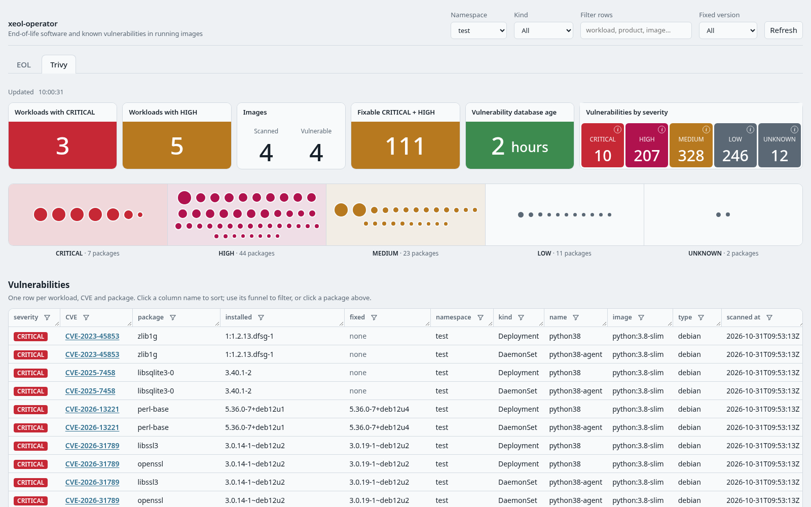

import { Aside, Tabs, TabItem } from '@astrojs/starlight/components';

xeol-operator finds end-of-life (EOL) software inside the images your cluster runs. Think of an old Python, a Node.js release past support, or a Debian version nobody patches any more.

It scans every running image and keeps the results current. You see them in Grafana, in Prometheus alerts, or in its own small web page.

This guide shows you how to install it with Helm, read the results, and tune what it scans. For more detail, see:

- [Helm setup](/xeol-operator/helm/#features): what each optional feature does and needs.
- [Helm setup](/xeol-operator/helm/): every Helm value.
- [Configuration](/xeol-operator/configuration/): every scan setting.
- [Air-gapped installation](/xeol-operator/air-gapped/): clusters without internet access.

## Before you start

You need:

- A Kubernetes cluster and Helm 3.
- Egress (outbound network access) from the cluster to `endoflife.date`, for the EOL data, and to the registries your images come from. No egress? Follow [Air-gapped installation](/xeol-operator/air-gapped/).
- Optional: kube-prometheus-stack (or any Prometheus Operator setup) for metrics and alerts.
- Optional: Grafana with the [Infinity](https://grafana.com/grafana/plugins/yesoreyeram-infinity-datasource/) plugin for the dashboard.

The operator image is on Docker Hub as [`rishang/xeol-operator`](https://hub.docker.com/r/rishang/xeol-operator). The chart pulls it by default, using the chart's `appVersion` as the tag.

## 1. Install

Add the chart repository:

```bash
helm repo add xeol-operator https://rishang.github.io/xeol-operator
helm repo update
```

Then pick the install that matches your cluster:

<Tabs syncKey="install">
<TabItem label="With Prometheus and Grafana">

For kube-prometheus-stack:

```bash
# serviceMonitor.enabled     Prometheus scrapes the EOL metrics (PromQL, history). Needs the Prometheus Operator.
# prometheusRule.enabled     Alert rules: EOL software running or due soon, stale DB, failing scans. Needs the ServiceMonitor.
# grafanaDatasource.enabled  Infinity datasource + dashboard, loaded by Grafana's sidecars. Needs the Infinity plugin.
helm install xeol-operator xeol-operator/xeol-operator -n xeol-system --create-namespace \
  --set serviceMonitor.enabled=true \
  --set prometheusRule.enabled=true \
  --set grafanaDatasource.enabled=true
```

Does your Prometheus only pick up ServiceMonitors and rules with a certain label? Then add that label, for example `--set serviceMonitor.labels.release=kube-prom-stack --set prometheusRule.labels.release=kube-prom-stack`.

</TabItem>
<TabItem label="Without Grafana">

Use the built-in web page and MCP tools instead:

```bash
# ui.enabled   Built-in web page at http://<port-forward>/: findings, timeline, workloads, namespaces.
# mcp.enabled  Read-only MCP tools at /mcp for AI assistants (status, namespaces, workloads, findings).
helm install xeol-operator xeol-operator/xeol-operator -n xeol-system --create-namespace \
  --set ui.enabled=true \
  --set mcp.enabled=true
```

</TabItem>
<TabItem label="From a git clone">

Install the chart from source for development, or to try unreleased changes:

```bash
git clone https://github.com/Rishang/xeol-operator.git && cd xeol-operator
helm install xeol-operator ./helm/xeol-operator -n xeol-system --create-namespace
```

Add the `--set` options from the other tabs as needed.

</TabItem>
</Tabs>

A few more install options:

- **Both sets of options:** you can enable the Grafana and the web page options together.
- **A specific release:** add `--version <version>`. `helm search repo xeol-operator --versions` lists the releases.
- **A specific operator version:** add `--set image.tag=<version>`.
- **A registry mirror:** set `image.repository`. Also set `imagePullSecrets` if the mirror needs credentials.

**Add vulnerability scanning** to either install with `--set trivy.enabled=true`. Trivy then checks the same SBOM (the list of packages in the image) against its vulnerability database.

- The pod downloads that database (~1.6 GB) before it turns Ready.
- So allow egress to `mirror.gcr.io` (or `ghcr.io`), or see [Air-gapped installation](/xeol-operator/air-gapped/#vulnerability-database-trivyenabled).
- See [Vulnerabilities (trivy)](#vulnerabilities-trivy) for what you get.

## 2. Check it's working

```bash
kubectl -n xeol-system get pods                                   # READY 1/1 once the EOL database is built
kubectl -n xeol-system port-forward svc/xeol-operator-metrics 8080 &
curl -s localhost:8080/api/v1/status
```

```json
{"images_tracked": 42, "images_scanned": 42, "workloads_eol": 7, "db_age_seconds": 180, "last_sweep": "2026-10-31T10:25:01Z", "config_error": "", ...}
```

What to look for:

- **Ready:** the pod turns Ready once the EOL database is built, about a minute after start. Scanning starts then.
- **`images_scanned`** grows towards `images_tracked`. By default, scans run one at a time and take roughly 5 to 60 seconds per image. So a large cluster takes a while on first start.
- **`last_sweep`** is set once every image has been scanned.
- **`workloads_eol`** is the number of workloads running software that is already past end of life.
- **`config_error`** stays empty while the [config file](/xeol-operator/configuration/) is valid.

Follow progress in the logs:

```bash
kubectl -n xeol-system logs deploy/xeol-operator -f | grep -E 'scanned|scan failed'   # one line per image
```

## 3. Read the results

Every view shows the same data:

- each running workload,
- the EOL products found in its images,
- the EOL date,
- how many days are left (negative once past).

"Due soon" means within the chosen window. The default window is 180 days.

### Grafana

With `grafanaDatasource.enabled`, open the **xeol: end-of-life software** dashboard. It has:

- headline numbers,
- an "EOL products per workload" table (red: past EOL, yellow: due within 6 months),
- the full findings list.

Use the variables at the top to narrow by namespace and kind, or to change the "Upcoming window".


### Built-in web page

With `ui.enabled`, start a port-forward:

```bash
kubectl -n xeol-system port-forward deploy/xeol-operator 8080
```

Then open `http://localhost:8080/`.


The page shows:

- **Tiles**: workloads past EOL, workloads due soon, days to the next EOL date, age of the EOL database, and failed scans by reason. Hover the ⓘ on a failure reason to see which workloads it affects.
- **Timeline**: one dot per product release, placed by EOL date. Dots left of the "today" line are already past EOL. Click a dot to filter the findings table to that release. Click it again to clear.
- **Findings table**: click a column name to sort. Use its funnel icon to filter by text or to tick specific values. Drag a header's corner to resize a column.
- **Workloads** and **Namespaces**: counts per workload and per namespace, worst first.

The controls at the top narrow everything: Namespace, Kind, Filter rows and Upcoming window. **Refresh** reloads the data.

### Vulnerabilities (trivy)

With `trivy.enabled`, the same scan also lists known vulnerabilities. The web page then gets two tabs: **EOL** and **Trivy**. With `eol.enabled=false`, it shows only the Trivy report.



The Trivy tab shows:

- **Tiles**:
  - workloads with a CRITICAL,
  - workloads with a HIGH (including those that also have a CRITICAL),
  - images scanned, and images with a CRITICAL or HIGH,
  - CRITICAL and HIGH vulnerabilities that have a fixed version,
  - the trivy database's age,
  - counts per severity.

  Counts are per image. So replicas, or several workloads on one image, don't multiply them.
- **Package strip**: one band per severity, CRITICAL on the left. Each dot is a vulnerable package. It sits in the band of its worst vulnerability and is sized by how many vulnerabilities it has. Click a dot to filter the table to that package. Click it again to clear.
- **Vulnerabilities table**: one row per workload, CVE and package, worst first. The columns are severity, CVE (linked to its advisory; hover for the title), package, installed and fixed version, then namespace, kind, name and image. It shows the first 1,000 rows. To see more, narrow it with the filters, or get every row from `/api/v1/vulnerabilities`.
- **Workloads** and **Namespaces**: CRITICAL, HIGH and fixable counts, worst first.

At the top, the **Fixed version** select replaces Upcoming window. It keeps only vulnerabilities that have a fix.

In Grafana, the `xeol: vulnerabilities (trivy)` dashboard has the same tiles and table, plus a Severity filter.

### Prometheus and PromQL

The operator serves metrics on port 8080 at `/metrics`. The metric's value is the EOL date. So you decide "how soon counts" in the query:

```txt
# already past EOL
xeol_eol_date_seconds < time()

# EOL within 90 days
(xeol_eol_date_seconds - time()) / 86400 < 90

# past-EOL findings per workload: join on the image digest
sum by (namespace, kind, name) (
  xeol_image_workload * on(digest) group_left count by (digest) (xeol_eol_date_seconds < time())
)
```

The full metric list is in the [README](https://github.com/Rishang/xeol-operator#metrics).

### JSON API

The same port serves read-only JSON. It's handy for scripts:

```bash
kubectl -n xeol-system port-forward svc/xeol-operator-metrics 8080
curl -s 'localhost:8080/api/v1/findings?within_days=0'          # already EOL
curl -s 'localhost:8080/api/v1/findings?namespace=prod&within_days=90'
curl -s localhost:8080/api/v1/status
```

**Endpoints:** `status`, `namespaces`, `workloads` and `findings`. With `trivy.enabled`, also `vulnerabilities`.

**Query parameters:**

- `namespace` and `kind`: comma-separated.
- `within_days`: default 180.
- `severity` (vulnerabilities only): comma-separated, e.g. `CRITICAL,HIGH`.

With trivy on, `status`, `workloads` and `namespaces` also include vulnerability counts.

```bash
curl -s 'localhost:8080/api/v1/vulnerabilities?severity=CRITICAL&namespace=prod'
```

### AI assistants (MCP)

With `mcp.enabled`, AI assistants can read the same four views as read-only MCP tools at `/mcp`. Vulnerabilities aren't an MCP tool yet. With the port-forward running, add the server:

```bash
claude mcp add --transport http xeol http://localhost:8080/mcp
```

Then ask, for example, "which workloads in prod run software that is already end of life?"

<Aside type="caution" title="No authentication">
The web page, JSON API and MCP have no authentication. Reach them through `kubectl port-forward`. Don't expose port 8080 through a public Ingress or LoadBalancer.
</Aside>

## 4. Choose what gets scanned

You set scan settings in Helm values under `scanner.*`. The chart writes them to the [config file](/xeol-operator/configuration/), which is the ConfigMap `xeol-operator-config`. Put them in a values file:

```yaml
# my-values.yaml
scanner:
  namespaceSelector:                 # only namespaces with this label; {} = all
    matchLabels: {xeol-scan: "true"}
  excludeNamespaces: ["kube-*", "monitoring"]
  excludeImages: ["*/busybox*"]      # globs on the image name
  workloadKinds: [Deployment, StatefulSet, DaemonSet]   # default also includes Job and CronJob
  workloadLabels: [team]             # adds a team label to metrics, for routing alerts
  interval: 24h                      # rescan each image this often
```

```bash
helm upgrade xeol-operator xeol-operator/xeol-operator -n xeol-system --reuse-values -f my-values.yaml
```

In globs (wildcard patterns), `*` matches anything, including `/`. `?` matches one character.

Changes apply without a restart:

- The operator reloads the file once the kubelet updates it, usually within a minute.
- You can also edit the ConfigMap directly: `kubectl -n xeol-system edit configmap xeol-operator-config`. But a later `helm upgrade` overwrites it from your values.
- A typo or bad value is rejected, and the previous config stays. See [Errors](/xeol-operator/configuration/#errors).

## 5. Accept a known finding

Sometimes you know about an EOL product and accept it. Maybe it's a test environment, or software you can't replace yet. Hide it with `ignoreProducts`.

The image is still scanned. The finding just disappears from metrics, alerts, the dashboard and the web page.

```yaml
scanner:
  ignoreProducts:
    - products: [perl]               # everywhere in namespace "test"
      namespaces: [test]
    - products: [python]             # only Python 3.8, only in the batch team's workloads
      cycles: ["3.8"]
      selector: {matchLabels: {team: batch}}
```

Use each product's [endoflife.date](https://endoflife.date) name, e.g. `python`, `nodejs`, `debian`. Not sure of the name? The `url` on each finding links to the product's page, which shows it.

## 6. Get alerted

With `prometheusRule.enabled`, the chart installs these alerts:

| Alert | Fires when |
|---|---|
| `XeolEOLSoftwareRunning` | A running image contains software past EOL. |
| `XeolEOLSoftwareSoon` | Software reaches EOL within `prometheusRule.eolSoonDays` (default 90). |
| `XeolDatabaseStale` | The EOL database is older than `prometheusRule.dbStaleDays` (default 30). |
| `XeolDatabaseMissing` | The operator has no EOL database. |
| `XeolScanErrors` | Images fail to scan. |

Route them in Alertmanager as usual. Want each team to get its own findings? Set `scanner.workloadLabels: [team]`, then join on `xeol_image_workload`.

## 7. Private registries

Do your Pods already pull from a private registry with `imagePullSecrets`? Then there's nothing to set up.

Here's how it works:

- Each scan reads the pull secrets of the Pod running the image, plus those of the Pod's ServiceAccount. This is the same thing the kubelet does.
- It reads each Secret from the API server when the scan starts.
- It writes the credentials to a `0600` file that only that scan's `syft` and `xeol` can see.
- It deletes the file afterwards.
- Credentials are never cached or logged.

What works:

- **Secrets of type `kubernetes.io/dockerconfigjson`** (and the older `kubernetes.io/dockercfg`) in the Pod's namespace. They must be referenced from the Pod's `imagePullSecrets` or its ServiceAccount's. Several secrets are merged, and the one for the image's registry is used.
- **Any registry that accepts those credentials**: Docker Hub, GHCR, GitLab, Harbor, Artifactory, ECR, ACR, GCR/Artifact Registry.

What doesn't:

- **Pulls that don't use a Secret.** Some nodes pull with a cloud identity: the EKS node role, IRSA, AKS kubelet identity, GKE node service account, or a kubelet credential provider. That works for the kubelet, but the operator can't see that identity. Those images fail with `reason="auth"`. To fix it, give the workload's ServiceAccount an `imagePullSecrets` entry, or add the images to `excludeImages`.
- **Short-lived tokens that nobody refreshes.** An ECR token in a Secret expires after 12 hours. Keep refreshing the Secret, with the usual CronJob or controller. The next scan reads the new one. A scan that fails with `auth` is retried after an hour.

Does an image have no pull secret? Create one and attach it to the ServiceAccount the workload uses:

```bash
kubectl -n payments create secret docker-registry regcred \
  --docker-server=registry.example.com --docker-username=<user> --docker-password=<token>
kubectl -n payments patch serviceaccount default -p '{"imagePullSecrets":[{"name":"regcred"}]}'
```

To see which images fail on credentials, check `xeol_scan_errors_total{reason="auth"}` or the failure tiles on the web page.

For this to work, the operator needs `get` on Secrets in every namespace. The chart grants it, and the operator never lists Secrets. If that's too broad for your cluster, skip those images with `excludeImages`.

Does the operator's own image come from a private registry? Then set `imagePullSecrets` in the chart values. That's a separate setting, for the operator's pod.

## Troubleshooting

**A workload is missing.** Check three things:

- Its namespace isn't excluded.
- Its top-level kind is in `scanner.workloadKinds` (e.g. Deployment, not ReplicaSet).
- Its image isn't excluded.

Images loaded straight onto nodes have no registry digest. They can't be scanned, so they're skipped.

**No findings, but I know something is old.** The operator only detects products that endoflife.date tracks. "No findings" means nothing *known* is EOL, not that nothing is.

**Failed scans.** `xeol_scan_errors_total` and the web page's failure tiles give the reason:

| Reason | Meaning | Fix |
|---|---|---|
| `auth` | The registry refused the pull. | Check the Pod's (or its ServiceAccount's) `imagePullSecrets`; see [Private registries](#7-private-registries). |
| `not_found` | The image digest is no longer in the registry. | Usually harmless. It goes away when the workload is redeployed. |
| `timeout` | The scan took longer than `scanner.timeout` (default 10m). | Raise `scanner.timeout`. |
| `oom` | The image needed more memory than the pod has. | Raise `resources.limits.memory` and `scanner.goMemLimit` together, e.g. `2Gi` and `1600MiB`. |
| `other` | Anything else. | See the operator's logs. |

An image that fails with `oom` is skipped for 24 hours.

**High `db_age_seconds` or `XeolDatabaseStale` alert.** The daily database rebuild is failing. Usually `endoflife.date` is unreachable. Meanwhile, the operator keeps using the last good database. Check egress, or switch to a mounted database ([Air-gapped installation](/xeol-operator/air-gapped/)).

**Pod not Ready.** The pod waits for the first database build. Check the logs for errors fetching `endoflife.date`.

## Upgrade and uninstall

To upgrade:

```bash
helm repo update
helm upgrade xeol-operator xeol-operator/xeol-operator -n xeol-system --reuse-values
```

A new pod rescans everything from scratch. Coming from a chart version with the `XeolScanner` CRD? See [Upgrading from the XeolScanner CRD](/xeol-operator/configuration/#upgrading-from-the-xeolscanner-crd).

To uninstall:

```bash
helm uninstall xeol-operator -n xeol-system
```
